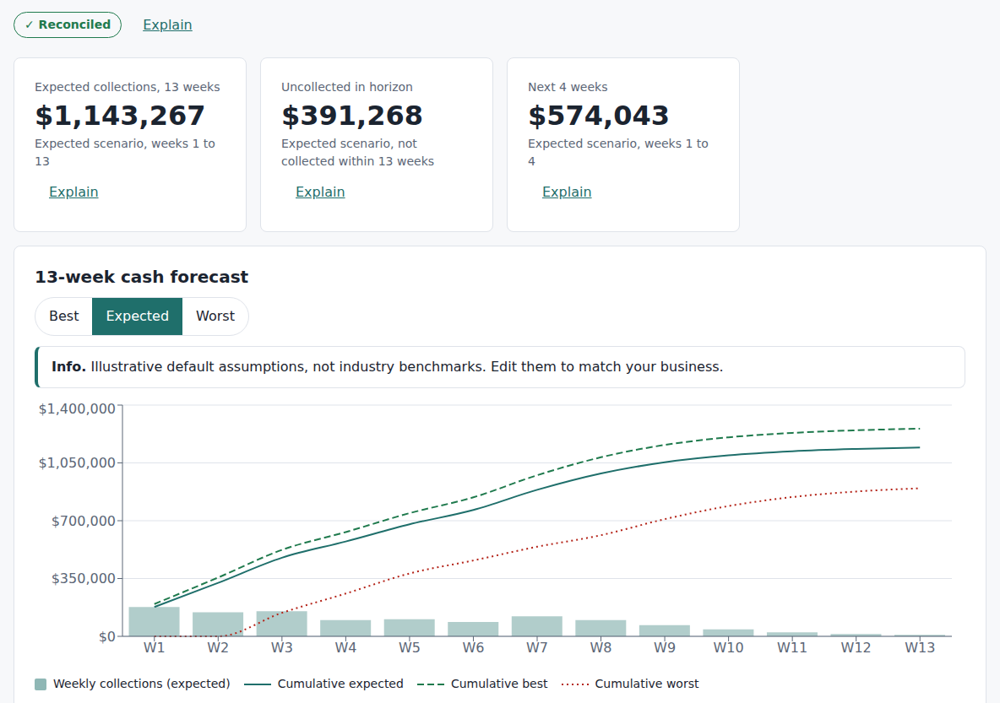
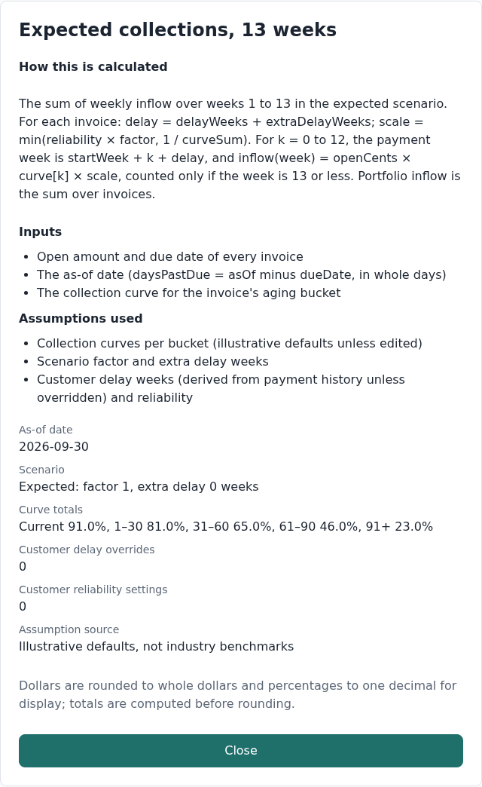
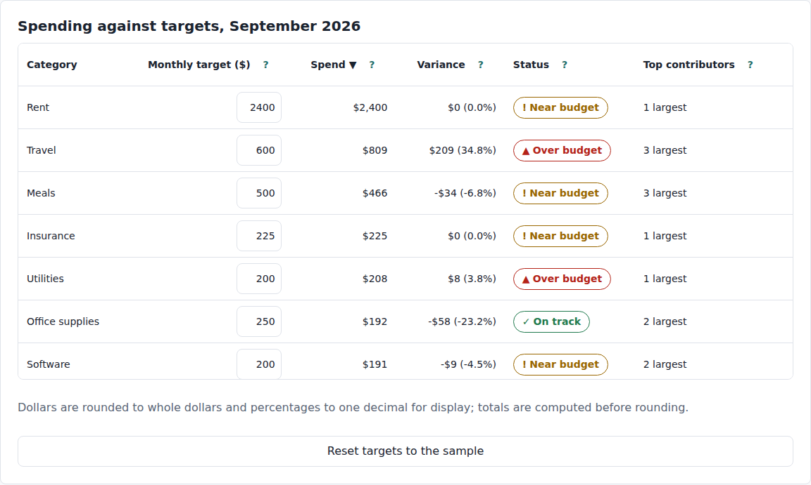

# CashCast

A browser-based tool that turns an accounts-receivable aging report into a transparent 13-week cash forecast, with a small budget-versus-actuals companion. Every figure traces to a formula and to an assumption you can read and change.

**[Live demo](https://bryankiansarmen.github.io/cashcast/)** · it opens on built-in sample data, so there is nothing to sign up for or set up.



**Jump to:** [Assumptions](#assumptions) · [What this doesn't handle yet](#what-this-doesnt-handle-yet) · [Run it](#run-it)

## The problem

A small business knows what customers owe it. It does not know *when* that will turn into cash, and a spreadsheet that guesses is hard to trust and easy to break. CashCast takes an aging report (who owes what, and how overdue it is), applies collection assumptions you can see and edit, and shows expected cash inflow week by week, with a best case and a worst case beside it.

It is a portfolio project. The sample data is fictional and generated from a fixed seed, so the demo and the tests always show the same numbers.

## What it does

- **Import** an AR aging CSV (or use the sample). Bad rows are listed by line, column, and message; one bad row stops the whole import, so a half-loaded dataset is never shown.
- **Aging summary** by bucket (current, 1–30, 31–60, 61–90, 91+ days past due) and by customer.
- **13-week forecast** under three scenarios, as a chart and an equivalent table.
- **Editable assumptions:** collection curves, scenario parameters, and per-customer delay and reliability. Invalid edits are blocked with a message and never reach the calculation.
- **Payment history (optional)** to derive how late each customer tends to pay.
- **"Explain" on every figure:** the formula, the inputs, and the assumption values in use.
- **Budget vs actuals:** import transactions, categorize them with ordered rules, set monthly targets, and see variance, status, and the largest contributors. Uncategorized transactions get a "create a rule" action that moves every match out of Uncategorized at once.
- Light and dark themes, a responsive layout, and keyboard-operable controls.

| An explain panel | The budget page |
|---|---|
|  |  |

## Approach

Everything that produces a number lives in a pure calculation engine (`src/engine`) with no access to React, the DOM, the clock, or the network. The as-of date is an argument. Layers only depend downward (`ui → state → viewmodels → engine`), and lint rules enforce it, so the interface cannot call the math directly.

**How an invoice becomes cash.** Each invoice line goes into an aging bucket by how many days past due it is. Each bucket has a collection curve: 13 percentages saying how much of an invoice tends to be paid in each week. An invoice's weekly cash is its open amount times the curve, scaled by the scenario and the customer, and shifted later by any delay. Whatever the curve does not collect within 13 weeks is reported as uncollected, not hidden.

A worked example from the test suite: a $10,000 invoice due 10 days before the as-of date sits in the 1–30 bucket. In the expected scenario it yields $3,000, $2,000, $1,200, $800, $500, $300, $200, and $100 in weeks 1 to 8: $8,100 collected and $1,900 uncollected.

**Money is integer cents.** Amounts are parsed from text without floating-point multiplication. The engine never rounds; only the display layer does, and the pages say so.

## Assumptions

The default collection curves are **illustrative, not industry benchmarks.** The app labels them that way wherever they are used, and you are meant to change them.

| Bucket | Share of an invoice collected within 13 weeks (default) |
|---|---|
| Current | 91% |
| 1–30 days past due | 81% |
| 31–60 | 65% |
| 61–90 | 46% |
| 91+ | 23% |

| Scenario | Collection factor | Extra delay |
|---|---|---|
| Best | 1.10 | none |
| Expected | 1.00 | none |
| Worst | 0.80 | 2 weeks |

- A curve is valid when it has 13 values between 0% and 100% adding up to at most 100%. Scenarios must stay ordered (best at least expected at least worst).
- **Customer delay** (0 to 8 weeks) shifts that customer's payments later. It can be derived from payment history: the mean number of days a customer paid after the due date, divided by 7 and rounded half up. It is only derived from **3 or more** paid invoices, and a value you type always wins.
- **Customer reliability** (0 to 100%) scales that customer's collections. It is manual only.
- Week *n* covers days as-of + 7(*n*−1) + 1 through as-of + 7*n*. Nothing is assumed to be paid before it is due.
- For budgets: a transaction's category is the one in the file if present, otherwise the first matching rule (case-insensitive text in the description), otherwise Uncategorized. A category is near budget at 90% of its target, over budget above it, and unbudgeted when it has spending but no target.

## Why this doesn't use AI for the numbers

Every number in CashCast comes from a formula you can read, applied to data you supplied and assumptions you can see. No figure is produced, adjusted, or "smoothed" by a language model.

- **Auditability.** The point of the product is that you can say *why* a number is what it is. A model's output cannot be traced to a rule.
- **Reproducibility.** The same input gives the same output, so the tests assert exact figures.
- **Reconciliation.** Forecasts must add up exactly to total open AR; that is a check, not a hope.
- **Privacy.** Pasted financial data never leaves the browser, which rules out sending it to a model service.

This is enforced rather than promised: a test fails if an AI SDK is added as a dependency, and every end-to-end test fails if the page makes any request to anything but the local server.

## How correctness is checked

- **Reconciliation on every forecast.** Five checks run before anything is displayed: inflows plus uncollected equal total open AR in each scenario; bucket totals add up to total open AR; every invoice's payment probabilities are valid; cumulative worst ≤ expected ≤ best in every week; no negative inflow and cumulative inflow never falls. If any check fails, the forecast is hidden and the failed checks are named.
- **Property tests** (fast-check) over generated portfolios and assumptions: reconciliation never fails, the curve validator agrees with the definition in both directions, scenarios stay ordered, shifting every date by the same number of days changes nothing, bucket totals add up.
- **Golden tests** reproduce the worked example above with literal expected values. The sample generators assert literal counts and totals.
- **Boundary tests** for status thresholds (89.99%, 90%, 100%, 100.01% of budget), bucket edges, and money and date parsing.
- **Imports** are validated at the boundary, and a failed import never replaces the data already loaded.
- **Suites:** 600+ unit tests, integration tests that push fixture CSVs through import, forecast, and reconcile, and 90+ end-to-end tests (Playwright against the production build), including accessibility scans (zero serious or critical findings on both pages, in both themes, at three screen widths), keyboard order, and a privacy test that plants a marker in imported data and checks it appears in no request and no browser storage. A separate suite checks the build under the GitHub Pages base path. Line coverage of the engine and budget code is 100% (a 95% threshold is configured).

Privacy and security: data stays in the browser. Only assumptions and the theme choice are saved, in local storage; imported data is not. The page ships a Content Security Policy (scripts, styles, and connections from the same origin only, no inline script or style). Because static hosting cannot set response headers, the policy is a meta tag, which cannot set `frame-ancestors` or reporting.

## What this doesn't handle yet

1. **One currency (USD).** No currency conversion, tax, or accounts payable.
2. **The default curves are not learned from your data.** Only per-customer delay is derived from history, and it needs 3 or more paid invoices per customer. Reliability is manual.
3. **No partial payments, seasonality, or disputes.** An invoice's expected cash is spread across the weeks by its curve; nothing models a customer paying part now and part later, a seasonal pattern, or a disputed invoice.
4. **Credits are excluded, not netted.** Negative balances are left out of the forecast and reported with a count and total, so a customer's net exposure can be overstated.
5. **Imported data is not saved.** Reloading the page returns to the sample. Assumptions and the theme persist; transactions, rules, budget targets, and imported invoices do not.
6. **Customers are matched by exact name** (ignoring case and extra spaces). There is no fuzzy matching, so history names must match the aging report's names. Budget category names also match exactly: "food" and "Food" are separate categories.
7. **Dates are ISO (`2026-09-30`) or US (`9/30/2026`) only**, and files are limited to 5 MB and 20,000 rows. Line numbers in error reports assume one record per line, so a quoted field containing a line break shifts the numbers after it.
8. **No comparison between imports** (what changed since last week), and no export of the forecast.
9. **Not tested with real assistive technology.** Automated accessibility checks and keyboard tests pass, but there has been no screen-reader session on a real device.
10. **A forecast is only as good as the assumptions.** The tool shows its work; it does not know your customers.

## Run it

Needs Node.js 22 or later.

```bash
npm install
npm run dev            # development server
npm run build          # type-check and production build
npm run preview        # serve the build at http://localhost:4173

npm run lint
npm run typecheck
npm run test              # unit tests
npm run test:integration  # fixture CSVs through import, forecast, and reconcile
npx playwright install chromium
npm run test:e2e          # end-to-end tests against the production build
npm run test:pages        # the build under the /cashcast/ Pages base path
npm run shots             # regenerate the screenshots in docs/screenshots
```

`VITE_BASE_PATH=/cashcast/ npm run build` builds for GitHub Pages. The deploy workflow does this and publishes after the main-branch checks pass.

## Project structure

```
src/
  engine/       forecast math: money, dates, aging, curves, scenarios, forecast, reconcile, customer delay
  budget/       categorization and variance (imports only engine/money and engine/dates)
  importers/    CSV reading, header mapping, AR, payment history, and transactions importers
  sample/       seeded sample data and the random generator
  viewmodels/   turn results into display structures; the only rounding happens here
  state/        the store (a reducer) and assumption persistence
  ui/           components, the two pages, styles and design tokens
tests/
  unit/ integration/ e2e/ pages/   test suites     fixtures/   CSV files, including malformed ones
  support/                         shared test helpers (network guard, console guard)
  shots/                           screenshot generator
docs/screenshots/                  images used above
.github/workflows/                 CI and the Pages deploy
```

## License

MIT. See [LICENSE](LICENSE).
